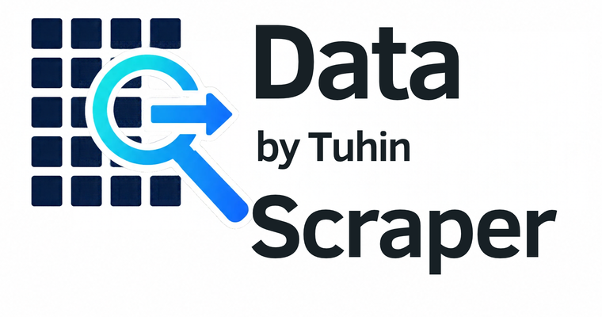

# Data Scraper by Tuhin



A Chrome extension for detecting structured data on web pages, previewing it in a table, collecting multiple pages, and exporting the result.

## Features

- Detects tables and repeating lists on the active page.
- Provides an editable preview before export.
- Exports data as CSV or Excel.
- Copies the detected table to the clipboard.
- Supports paginated and infinite-scroll collection.
- Uses a responsive black interface with loading and working animations.
- Includes no AI Work Profile/avatar interface.
- Limits visible external profile links to the maintainer's GitHub and LinkedIn pages.
- Disables inherited remote analytics, configuration, and telemetry endpoints in this GitHub build.

## Install locally

1. Download or clone this repository.
2. Open `chrome://extensions` in Chrome.
3. Enable **Developer mode**.
4. Select **Load unpacked**.
5. Choose this repository's root folder.
6. Open a page containing a table or repeating list and launch the extension.

## Usage

1. Open the page containing the data you need.
2. Launch Data Scraper from the Chrome toolbar.
3. Review the detected table and switch tables if necessary.
4. Restore or remove columns and rename headings as needed.
5. For multi-page results, choose the page's pagination control and start collection.
6. Export as CSV or Excel, or copy the table directly.

## Privacy

The GitHub build uses `src/background-wrapper.js` to prevent inherited analytics and remote-configuration integrations from making network requests. Features that depended on those retired remote services may therefore be unavailable. Core page detection, preview, crawling, copying, and file export remain available.

The extension requests access to web pages because scraping requires reading the active page and interacting with pagination controls. Review [manifest.json](manifest.json) before installing if you want to inspect the complete permission list.

## Project structure

```text
manifest.json                 Chrome extension configuration
src/popup.html                Scraper interface entry point
src/popup.css                 Black popup theme and animations
src/brand-ui.js               Branding, profile links, and UI cleanup
src/background-wrapper.js     Privacy boundary for retired integrations
src/options/                  Setup and review experience
_locales/en/messages.json     User-facing English copy
js/                           Bundled third-party browser libraries
css/                          Bundled third-party styles
```

## Validation

The repository does not require a build step. After making changes, validate the JavaScript and JSON files:

```bash
node --check src/background-wrapper.js
node --check src/background.js
node --check src/brand-ui.js
node --check src/popup.js
node --check src/options/options.js
node -e 'JSON.parse(require("fs").readFileSync("manifest.json", "utf8"))'
node -e 'JSON.parse(require("fs").readFileSync("_locales/en/messages.json", "utf8"))'
```

## Publish to GitHub

Create an empty repository on GitHub, then run the following commands from this folder. Replace the remote URL with your new repository URL.

```bash
git init
git add .
git commit -m "Initial release"
git branch -M main
git remote add origin https://github.com/TuhinSubhraSikdar/YOUR_REPOSITORY.git
git push -u origin main
```

## Third-party software

This repository contains bundled third-party libraries including Bootstrap, jQuery, Handsontable, Papa Parse, FileSaver, SheetJS-related export code, and js-sha256. Their original copyright and license notices remain in the corresponding files and continue to apply to those components. Do not remove those notices when redistributing the repository.

No project-level open-source license is included. Without a separate license file, the repository is not automatically licensed for reuse or redistribution beyond rights granted by the third-party components.

## Maintainer

- [GitHub](https://github.com/TuhinSubhraSikdar)
- [LinkedIn](https://in.linkedin.com/in/tuhin-subhra-sikdar)

